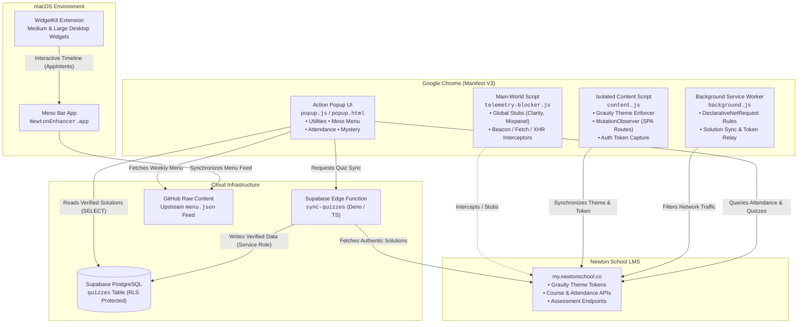

<div align="center">


# newNewton

**A high-performance Manifest V3 browser extension and native macOS desktop companion for Newton School.**

Seamless theme switching, zero-overhead telemetry blocking, intelligent attendance analytics, live campus dining schedules, and automated assessment management.

<p align="center">
  <a href="https://github.com/suwupnil/newNewton"></a>
  <a href="extension/manifest.json"></a>
  <a href="macos/"></a>
  <a href="scripts/build.js"></a>
  <a href="package.json"></a>
</p>

[Overview](#overview) • [Key Features](#key-features) • [System Architecture](#system-architecture) • [Technology Stack](#technology-stack) • [Getting Started](#getting-started) • [Directory Structure](#directory-structure) • [Acknowledgements](#acknowledgements)

</div>

---

## Overview

The Newton School LMS (`my.newtonschool.co`) is a modern Next.js single-page application. While feature-rich, daily usage presents specific friction points for students:

1. **Theme Inconsistencies**: The internal Grauity design system includes native dark styling (`grauity-theme-dark`), but SPA client routing frequently strips theme classes on route transitions.
2. **Aggressive Telemetry**: Heavy third-party tracking scripts (Microsoft Clarity session recorders, Mixpanel, CleverTap, OpenPanel, and diagnostic report uploads) run continuously during active sessions.
3. **Complex Attendance Calculations**: Course theory and practical units are listed separately, requiring manual arithmetic to calculate real attendance, safe absences ("bunks"), and recovery trajectories.
4. **Scattered Campus Information**: Dining hall menus and daily schedules require external checks rather than integrating directly into the browser or desktop workspace.

**newNewton** solves these issues through a unified client architecture: a lightweight Manifest V3 Chrome Extension and a standalone Swift/WidgetKit native macOS application.

---

## Key Features

<table>
  <tr>
    <td width="50%" valign="top">
      <h3>Native Grauity Theme Switcher</h3>
      <ul>
        <li><b>Zero Custom Overrides</b>: Interfaces directly with Newton's native <code>grauity-theme-dark</code> and <code>grauity-theme-light</code> CSS tokens.</li>
        <li><b>SPA Transition Defense</b>: Uses a persistent <code>MutationObserver</code> to ensure dark mode remains intact across Next.js dynamic route transitions.</li>
        <li><b>3-Mode Support</b>: Seamlessly switch between Light, Dark, or System mode with automatic OS color-scheme synchronization.</li>
      </ul>
    </td>
    <td width="50%" valign="top">
      <h3>Dual-Layer Privacy Shield</h3>
      <ul>
        <li><b>Network Layer</b>: DeclarativeNetRequest dynamic rules prevent tracking calls from initiating across Google Analytics, Clarity, Mixpanel, and diagnostic endpoints.</li>
        <li><b>In-Page Recursive Stubs</b>: Runs in the page's <code>MAIN</code> execution context to stub global tracking objects, preventing React/Next.js script crashes.</li>
        <li><b>Diagnostic Interception</b>: Silently captures <code>sendBeacon</code>, <code>fetch</code>, and <code>XMLHttpRequest</code> payloads targeting report endpoints.</li>
      </ul>
    </td>
  </tr>
  <tr>
    <td width="50%" valign="top">
      <h3>Attendance Rollup & Projections</h3>
      <ul>
        <li><b>Automatic Course Pairing</b>: Groups corresponding theory, lab, and workshop sections into consolidated subject records.</li>
        <li><b>Absence Budgeting</b>: Computes the exact number of classes you can miss while maintaining safety thresholds (75%, 80%, or 85%).</li>
        <li><b>Recovery Math</b>: Calculates consecutive classes needed to return to good standing, with full semester timetable projections.</li>
      </ul>
    </td>
    <td width="50%" valign="top">
      <h3>Live Campus Mess Menu</h3>
      <ul>
        <li><b>Weekly Auto-Refresh</b>: Pulls live weekly menus with automatic Monday cache invalidation and offline fallbacks.</li>
        <li><b>Smart Course Classification</b>: Intelligently separates signature main courses from daily staples (chapati, rice, dal, tea).</li>
        <li><b>Meal Window Detection</b>: Real-time status indicators highlight current meal services ("Serving Now") and upcoming courses.</li>
      </ul>
    </td>
  </tr>
  <tr>
    <td width="50%" valign="top">
      <h3>Quiz Engine & Submission Manager</h3>
      <ul>
        <li><b>Zero-Write Client Model</b>: Solutions are archived securely via backend Supabase Edge Functions with PostgreSQL Row Level Security (RLS).</li>
        <li><b>Option Shuffle Defense</b>: Matches questions by cleaned text content rather than fragile indices or letters.</li>
        <li><b>Humanized Submission ("Lazy Submit")</b>: Configurable per-question delays with entropy jitter (randomized time distribution) to emulate organic pacing.</li>
      </ul>
    </td>
    <td width="50%" valign="top">
      <h3>Native macOS Desktop Widgets</h3>
      <ul>
        <li><b>WidgetKit Integration</b>: Interactive 2x1 (Today's Meals) and 2x2 (Weekly Schedule) widgets for macOS Desktop and Notification Center.</li>
        <li><b>Interactive Day Switching</b>: Swift AppIntents allow flipping through days directly from the widget surface.</li>
        <li><b>Menu Bar Companion</b>: Discreet status bar item providing immediate meal context and manual refresh triggers.</li>
      </ul>
    </td>
  </tr>
</table>

---

## System Architecture



### Security & Privacy Design

- **Client Privilege Isolation**: Extension clients hold zero write permissions (`INSERT`/`UPDATE`/`DELETE` are strictly revoked from `anon` and `authenticated` roles in PostgreSQL).
- **Backend Verification**: Assessment synchronization is handled exclusively by an isolated Edge Function running on AWS Mumbai (`ap-south-1`) with `service_role` credentials.
- **Fail-Safe Proxies**: Tracking object stubs use recursive JavaScript `Proxy` instances so that deep chains like `mixpanel.people.set(...)` or `clarity('set', ...)` succeed harmlessly without throwing runtime exceptions.

---

## Technology Stack

| Layer | Technologies & Frameworks | Purpose |
| :--- | :--- | :--- |
| **Chrome Extension** | Manifest V3, Modern ES Modules, Chrome Extension APIs | Core client logic, UI popup, and content script injection |
| **Native macOS App** | Swift 5.9+, SwiftUI, WidgetKit, AppIntents, AppKit | Desktop widgets, timeline providers, and menu bar companion |
| **Backend & Storage** | Supabase, PostgreSQL, Row Level Security, Deno, TypeScript | Solution caching, edge synchronization, and secure REST endpoints |
| **Build & Tooling** | Node.js, esbuild, Terser, GitHub Actions, crx3 | Automated linting, minification pipeline, and packaging |

---

## Getting Started

### Prerequisites

- **Google Chrome**, **Brave**, or any Chromium-based browser supporting Manifest V3.
- **Node.js 20+** and **npm** (for building extension artifacts).
- **macOS 14.0+ (Sonoma)** and **Xcode 15+** (optional, for compiling native widgets).

---

### 1. Chrome Extension Installation

#### Method A: Load from Source (Developer Mode)

```bash
# Clone the repository
git clone https://github.com/suwupnil/newNewton.git
cd newNewton

# Install dev dependencies
npm install

# Run the automated build & minification pipeline
npm run build
```

1. Open your browser and navigate to `chrome://extensions/`.
2. Toggle on **Developer mode** in the top-right corner.
3. Click **Load unpacked** in the top-left corner.
4. Select the generated `dist/extension/` directory (or the source `extension/` directory).

#### Method B: Pre-Packaged Release

1. Download the latest `.crx` or `.zip` archive from [Releases](https://github.com/suwupnil/newNewton/releases).
2. For `.crx`: Drag and drop the file directly onto `chrome://extensions/`.
3. For `.zip`: Unpack the archive and load it via **Load unpacked**.

---

### 2. Native macOS Widgets Installation

To build and run the native desktop widgets:

```bash
cd macos

# Run the automated compilation and packaging script
./build.sh
```

The script compiles the container app and WidgetKit extension, copies bundles, signs the binaries with an ad-hoc signature, and places `NewtonEnhancer.app` into `macos/build/`.

To add the widget to your desktop:
1. Launch `macos/build/NewtonEnhancer.app`.
2. Right-click anywhere on your desktop wallpaper and select **Edit Widgets…**.
3. Search for **Campus Mess Menu** or **Newton** in the gallery.
4. Drag either the **Medium (2x1)** or **Large (2x2)** widget directly onto your screen.

---

## Build & Validation Pipeline

The project includes an automated multi-stage build script (`scripts/build.js`):

```bash
# Execute full validation and minification
npm test
```

The pipeline executes three automated phases:

1. **Syntax & Type Validation**:
   - Validates Edge Function TypeScript syntax (`deno check` or `esbuild`).
   - Verifies all source JavaScript files with `node --check`.
2. **Minification & Asset Compaction**:
   - Minifies JavaScript using Terser (with proper `--module` handling for ES Modules).
   - Bundles and compresses CSS styles using esbuild.
   - Verifies and compacts JSON data files while formatting `manifest.json`.
3. **Integrity Verification**:
   - Runs `node --check` against all minified outputs in `dist/extension/`.
   - Verifies manifest configuration and extension key presence.

---

## Directory Structure

```text
newNewton/
├── .github/
│   └── workflows/
│       └── deploy-and-release.yml   # CI/CD: build, CRX packaging, and GitHub releases
├── documentation/
│   ├── NEWTON_API_REFERENCE.md      # Reverse-engineered Newton School LMS API specs
│   └── NEWTON_QUIZ_API_SPECIFICATION.md
├── extension/                       # Chrome Manifest V3 Extension
│   ├── manifest.json                # Extension manifest & permissions
│   └── src/
│       ├── background.js            # Service worker & declarativeNetRequest rules
│       ├── content.js               # Theme enforcer & DOM state synchronizer
│       ├── telemetry-blocker.js     # Main-world script & crash-proof tracking stubs
│       ├── quiz-client.js           # Supabase PostgREST client & quiz submission logic
│       ├── popup.html               # Multi-tab popup user interface
│       ├── popup.css                # Material Design 3 styles (Dark/Light mode)
│       ├── popup.js                 # Popup controller & tab navigation
│       ├── attendance/              # Attendance arithmetic and subject rollups
│       │   ├── grouping.js          # Course section and lab pairing algorithms
│       │   ├── math.js              # Pure attendance calculations & projections
│       │   └── portal-api.js        # Authenticated LMS data fetching service
│       ├── menu.json                # Bundled fallback dining hall menu
│       └── icons/                   # Extension icons (16px, 48px, 128px)
├── macos/                           # Standalone native macOS application
│   ├── build.sh                     # Automated compiler, bundler, and packager
│   ├── Resources/                   # Info plists and entitlement definitions
│   └── Sources/
│       ├── App/                     # Menu bar container app (AppKit / SwiftUI)
│       ├── Shared/                  # Shared models, dish classification, and data caching
│       └── Widgets/                 # WidgetKit timeline providers and views
├── supabase/                        # Backend cloud definitions
│   ├── schema.sql                   # PostgreSQL tables, indexes, and RLS policies
│   └── functions/
│       └── sync-quizzes/            # Deno/TypeScript assessment synchronization service
├── menu.json                        # Master campus mess menu data
├── package.json                     # Node project manifest & build dependencies
├── scripts/
│   └── build.js                     # Multi-stage minifier and code validation tool
└── updates.xml                      # Google Update Protocol 2.0 auto-update manifest
```

---

## Usage Guide

### Chrome Extension Popup Navigation

Clicking the newNewton extension icon in Chrome opens a responsive four-tab interface:

- **Utilities Tab**:
  - Toggle between **Light**, **Dark**, or **System** themes. Changes apply instantly to Newton School and persist across visits.
  - Enable or disable the **Telemetry & Tracking Blocker** to halt diagnostic uploads and tracker pixels.
- **Mess Menu Tab**:
  - Browse breakfast, lunch, snacks, and dinner for any day of the week.
  - Specials and signature dishes are highlighted with badges; everyday staples are cleanly grouped.
  - Hit the refresh button to synchronize the latest menu changes directly from GitHub.
- **Attendance Tab**:
  - View consolidated attendance metrics across all enrolled courses.
  - Switch between safety thresholds (75%, 80%, 85%) to see exact allowable absences or required classes.
- **Mystery Tab**:
  - Scan for unsubmitted assessments across enrolled courses.
  - Activate **Lazy Submit** to set human-like delays with randomized entropy jitter.
  - Monitor real-time submission progress with pause, fast-forward, and cancel controls.

---

## Acknowledgements

- **Mess Menu Data**: Weekly campus menus maintained upstream by [Garvit-png](https://github.com/Garvit-png).
- **Attendance Rollup Logic**: Course grouping algorithms and arithmetic models inspired by [nst-attendance](https://github.com/yats0x7/nst-attendance) by [yats0x7](https://github.com/yats0x7).
- **Design Tokens**: Native interface styles built on Newton School's internal *Grauity* theme system.

---

<div align="center">
  <sub>Built for students and developers across the Newton School community.</sub>
</div>